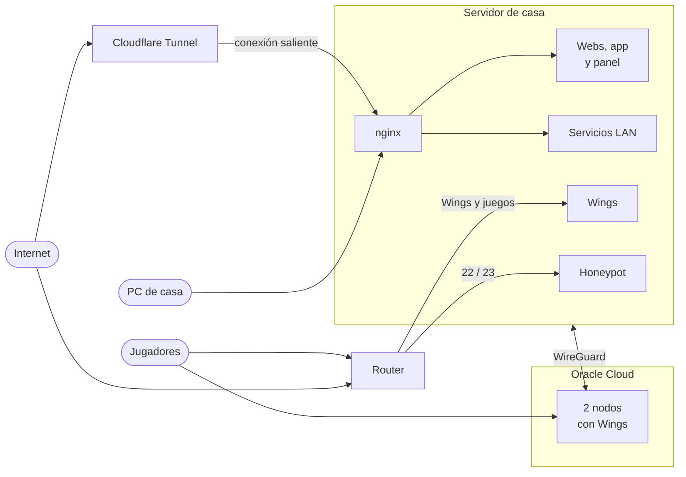

# homelab

Cómo está montado mi servidor casero: qué corre, cómo se expone, cómo se hacen y se comprueban los backups, cómo me entero de que algo va mal y cómo se despliega. Es una máquina en casa y dos nodos en la nube, pero lo trato como si fuera producción, porque una parte lo es: aloja los servidores de juego de amigos y conocidos.

**Documentación completa: [isderky.github.io/homelab](https://isderky.github.io/homelab/)** (sale de [`docs/`](docs/)).

Aquí no hay IPs, dominios ni credenciales. La configuración está en [`ansible/`](ansible/), con los valores y secretos en un repo privado. El código de cada pieza va en su propio repo: [cowrie-honeypot](https://github.com/IsDerky/cowrie-honeypot), [asistente-ops](https://github.com/IsDerky/asistente-ops) (recolector, bot y vigilante) y [oficina-pixel](https://github.com/IsDerky/oficina-pixel) (el panel).

## Máquinas

- **Servidor de casa.** Dell OptiPlex con un i5-8500, 38 GB de RAM y un SSD de 256 GB, más un SSD NVMe externo por USB-C para la copia local y el NAS. Ubuntu Server 24.04.
- **Dos nodos en Oracle Cloud** (ARM). Solo Docker y Wings, gestionados desde el panel de casa y unidos al servidor por WireGuard.

## Qué corre

| Servicio | Se llega por |
|---|---|
| [App web propia](https://github.com/IsDerky/bentonime-showcase), dos webs más, el panel de Pterodactyl y code-server | Cloudflare Tunnel (el router no abre web) |
| Wings y servidores de juego (casa y nodos) | Directo: puertos del router / IP del nodo |
| AdGuard Home + Unbound, Vaultwarden, Homepage, Grafana, panel de estado, NAS | Solo LAN, cada uno con su nombre y HTTPS |
| Honeypot Cowrie | Puertos 22 y 23 del router, aislado con iptables |
| Prometheus, Alertmanager, bot de operaciones, runners de CI | No escuchan fuera |

## Lo más interesante

- **Backups que se prueban**: restic a Google Drive y a un disco local, y un simulacro mensual que restaura y comprueba lo restaurado. Los nodos no guardan credenciales: el servidor se trae sus volúmenes con una clave que solo puede leer. → [Backups](https://isderky.github.io/homelab/backups/)
- **Vigilancia en dos partes**: un Worker de Cloudflare que espera latidos (si el servidor muere entero, avisa igual) y Prometheus + Grafana con reglas probadas en el CI. Solo avisa de lo que importa. → [Vigilancia](https://isderky.github.io/homelab/vigilancia/)
- **Despliegue sin dar poder al runner**: el runner solo puede pedir que se instale un commit que ya está en `main`; el código lo trae otro proceso con una clave de solo lectura. Workflows comunes en [IsDerky/ci](https://github.com/IsDerky/ci) y Renovate con las sumas SHA-256 ya puestas. → [CI/CD](https://isderky.github.io/homelab/cicd/)
- **Endurecimiento medido**: auditoría con Lynis antes y después (67/69/69 → 72/76/75), túnel WireGuard para las métricas de los nodos, SSH solo con clave y aviso de cada inicio de sesión. → [Red y seguridad](https://isderky.github.io/homelab/red-y-seguridad/)
- **Todo en Ansible**: `site.yml` aplica el servidor entero y una segunda pasada da `changed=0`. Cada rol nuevo se prueba antes en contenedores con systemd. → [Roles](ansible/README.md)

## Licencia

MIT
