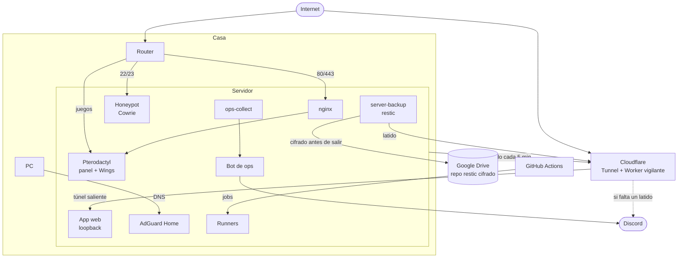

# homelab

Cómo está montado mi servidor casero: qué corre, cómo se expone, cómo se hacen y se comprueban los backups, cómo me entero de que algo va mal y cómo se despliega. Es una sola máquina, pero la trato como si fuera producción, porque una parte lo es: aloja los servidores de juego de amigos y conocidos.

Aquí no hay IPs, dominios ni credenciales. El código de cada pieza está en su propio repo: [cowrie-honeypot](https://github.com/IsDerky/cowrie-honeypot), [asistente-ops](https://github.com/IsDerky/asistente-ops) (recolector, bot y vigilante) y [oficina-pixel](https://github.com/IsDerky/oficina-pixel) (el panel).

## Máquina

- Dell OptiPlex con un i5-8500 (6 núcleos), 38 GB de RAM y un SSD de 256 GB.
- Ubuntu Server 24.04, sin escritorio.

## Qué corre

| Servicio | Cómo | Expuesto |
|---|---|---|
| [App web propia](https://github.com/IsDerky/bentonime-showcase) (Next.js + SQLite) | systemd, usuario propio, solo escucha en loopback | Cloudflare Tunnel |
| Pterodactyl (panel + Wings) | nginx + PHP + MariaDB + Redis; Wings con Docker | nginx con HTTPS |
| Nodos remotos de Pterodactyl | dos máquinas más con Wings, gestionadas desde el mismo panel | — |
| AdGuard Home | Docker | Solo LAN (DNS y DoH) |
| Honeypot Cowrie | Docker, aislado con iptables | Puertos 22 y 23 del router |
| Bot de operaciones | Bun + discord.js, systemd con `ProtectSystem=strict` | Sale a Discord, no escucha fuera |
| Panel de estado | Web estática + API local del bot | Solo LAN |
| Prometheus, Alertmanager, Grafana | Docker Compose con la red del host, solo loopback | Grafana solo LAN, por nginx |
| Runners de GitHub Actions | Un runner por repo, usuario sin shell | Solo salida a GitHub |

## Red y exposición

- **Abierto en el router**: HTTP/HTTPS, la API y el SFTP de Wings, un rango para los juegos y el honeypot. El SSH real no se abre a internet.
- **La app web no abre ningún puerto**: sale por Cloudflare Tunnel (conexión saliente desde el servidor) y solo escucha en `127.0.0.1`.
- **Servicios internos solo en LAN**: nginx los limita a la red de casa. Usan certificados de Let's Encrypt emitidos con DNS-01, así que no hace falta exponerlos para tener HTTPS.
- **ufw** deniega por defecto lo entrante y lo enrutado. Ojo: lo que publica Docker no pasa por ufw. El honeypot se aísla con reglas en `DOCKER-USER`.

## Seguridad

- **Hardening inicial**: fuera escritorio, CUPS, VNC, ModemManager, snaps y servicios que no se usaban.
- **Usuarios por servicio**: cada app corre con su usuario. La app web solo puede reiniciar su propio servicio vía sudo; el bot solo puede lanzar dos acciones concretas mediante una regla de polkit.
- **fail2ban** con filtros propios para el SFTP de Wings, que es donde llegan los ataques de verdad. Una jaula para usuarios inexistentes (3 intentos y baneo creciente) y otra para fuerza bruta.
- **Aviso de inicio de sesión**: PAM llama a un script en cada sesión SSH y manda un DM, salvo desde mi PC. Es `optional`: si falla, no impide entrar.
- **Cuenta de auditoría de solo lectura**: entra solo con clave, solo desde mi PC, sin TTY ni reenvíos, y con sudo limitado a una lista de comandos con argumentos fijos (`ss`, `docker ps`, `ufw status`, `fail2ban-client status`…).
- **SMART** vigilado con smartd, con aviso por DM.

## Backups

restic sobre rclone a Google Drive. Todo se cifra en el servidor antes de subirlo. Un script (`server-backup`) con cuatro modos, cada uno con su timer de systemd:

| Modo | Cuándo | Qué hace | Retención |
|---|---|---|---|
| `sistema` | Cada 6 h | BD de la app (`sqlite3 .backup`), dump del panel, `/etc`, `/opt`, scripts, crons | 7 diarios, 4 semanales, 12 mensuales |
| `clientes` | A diario | Volúmenes y backups de los servidores de juego | 7 diarios, 4 semanales, 3 mensuales |
| `mantenimiento` | Domingos | `prune` y `check` de una cuarta parte de los datos (cada mes se verifica todo) | — |
| `simulacro` | Primer domingo de mes | Restaura en `/var/tmp`, pasa `integrity_check` a la BD, comprueba el dump del panel y un fichero de un servidor de juego | — |

Los volúmenes de los servidores de juego se copian como ficheros desde el host, sin ejecutar nada dentro de sus servidores. Es una copia "como si se fuera la luz" (crash-consistent); por eso se guardan varias versiones.

Un backup que nunca se ha restaurado no es un backup. El simulacro mensual existe por eso, y su resultado también se vigila (ver abajo).

## Vigilancia

Dos partes, para que un fallo del servidor no apague también el aviso.

**Vigilante externo** (Cloudflare Worker con cron cada 5 minutos y KV). El servidor y los backups le mandan latidos. Si alguno no llega a tiempo, me escribe por Discord:

| Señal | Plazo |
|---|---|
| Servidor | 15 min |
| Backup del sistema | 13 h |
| Backup de los servidores de juego | 30 h |
| Simulacro de restauración | 40 días |

Avisa una vez al pasarse el plazo, recuerda cada 24 h y avisa cuando vuelve. El Worker, su KV y el cron también están declarados en [Terraform](https://github.com/IsDerky/asistente-ops/tree/main/watchdog/terraform). Es el patrón *dead man's switch*: si el servidor muere entero, nadie mandaría el aviso desde dentro.

**Recolector** (`ops-collect`, Python sin dependencias, timer cada 5 minutos). Junta en un JSON el estado del sistema, SMART, servicios, backups, `docker stats`, certificados, fail2ban y el honeypot. También procesa el journal y agrupa los mensajes de log por huella, para detectar lo que es nuevo.

**Bot de operaciones** (Discord, solo DMs y solo yo). Lee el JSON y responde a preguntas tipo "¿cómo van los backups?" usando un LLM con herramientas. Las acciones (reiniciar la app, lanzar un backup) solo se ejecutan con un botón que caduca a los 10 minutos: el modelo propone y yo confirmo. Manda un resumen diario por la mañana y lleva las caducidades de certificados y del dominio.

**Métricas** (Prometheus + Grafana, [rol `monitoring`](ansible/README.md#rol-monitoring)). node_exporter para la máquina, blackbox para comprobar la app web desde fuera del proceso, y un exportador propio en Python que convierte el JSON del recolector en métricas. Dos dashboards: el servidor, y la app con su disponibilidad y los backups. Alertmanager solo avisa de lo que no cubre lo anterior: que la app falle lo bastante como para comerse su margen de error del mes (SLO del 99,5 %), disco o memoria a punto de acabarse, y que la propia monitorización deje de ver algo.

Solo me avisa de lo que importa: servidor caído, backup fallido, alguien que inicia sesión, algo que caduca. Probé a avisar de anomalías en los logs y era ruido, así que el bot las aprende en silencio y me las cuenta solo si le pregunto.

## CI/CD

Push a `main` = despliegue. Hay dos variantes:

**Repos de infraestructura** (bot, panel, honeypot, webs):
- Un runner autoalojado por repo, con un usuario `deployer` sin shell.
- Lo único que `deployer` puede hacer con sudo es `deploy-repo <repo> <sha>`.
- `deploy-repo` no usa el código del runner: se trae el repo con una deploy key de solo lectura y solo instala commits que ya estén en `origin/main`. Si alguien tomara el runner, solo podría desplegar lo que ya está publicado, no colar código propio como root.

**App web**, por versiones:
1. CI en GitHub: lint, tipos, migraciones contra una BD vacía, tests y build.
2. En el servidor: `git worktree` en `releases/<sha>`, build con una BD desechable, backup de la SQLite, migraciones, cambio atómico del enlace `current` y reinicio.
3. Health check. Si falla, rollback automático a la versión anterior. Se guardan 3 versiones.
4. Aviso por Discord con el resultado.

## Decisiones y compromisos

- **Una máquina, sin Kubernetes.** systemd y Docker Compose cubren lo que necesito con mucha menos complejidad. Cada servicio es una unidad con su usuario y sus límites.
- **Un solo disco.** Es el punto débil. Lo cubro con backups fuera de casa cada 6 h y simulacros mensuales; el siguiente paso es un segundo SSD para tener también copia local (3-2-1).
- **Google Drive como destino de backups.** Ya tenía el espacio pagado y restic cifra antes de subir, así que el proveedor no ve nada. La app OAuth de rclone solo tiene acceso a los ficheros que crea ella.
- **Cloudflare Tunnel para la app web.** No abro puertos y Cloudflare filtra por delante. El precio es depender de un tercero para ese servicio.
- **Configuración en Ansible** ([`ansible/`](ansible/)). Empezó como scripts en bash idempotentes: para una máquina funcionaban, pero reconstruirla desde cero costaba. Ahora SSH, cortafuegos, fail2ban, backups, avisos, nginx, el túnel y las webs son roles, y `site.yml` aplica el servidor entero (una segunda pasada da `changed=0`). Los valores y secretos van en un repo privado con Ansible Vault. El honeypot además se prueba en el CI aplicándolo de verdad sobre el runner.
- **El bot no tiene poder propio.** Todo lo que puede hacer está en una lista blanca con permisos mínimos (polkit o sudoers con argumentos fijos) y necesita mi clic.

## Pendiente

- Traer las dos webs que quedan en un VPS que no se renueva ([runbook](docs/runbook-migracion-vps.md)). Preparadas y apagadas; falta el corte de DNS.
- Segundo SSD para copia local.
- Resolver DNS recursivo propio (Unbound) detrás de AdGuard.
- Pila de la BIOS y arranque automático tras un corte de luz.
- Reconstruir el servidor en una VM vacía solo con `site.yml`, para probar que de verdad basta.

## Licencia

MIT
