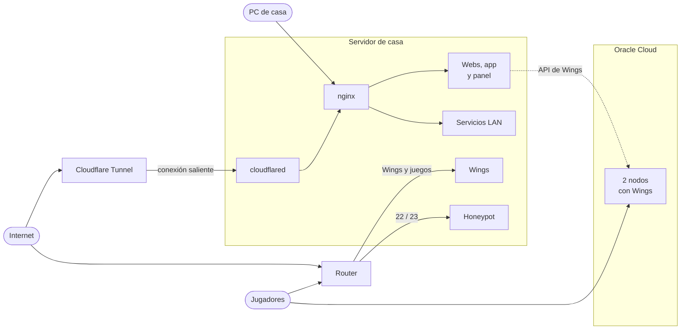
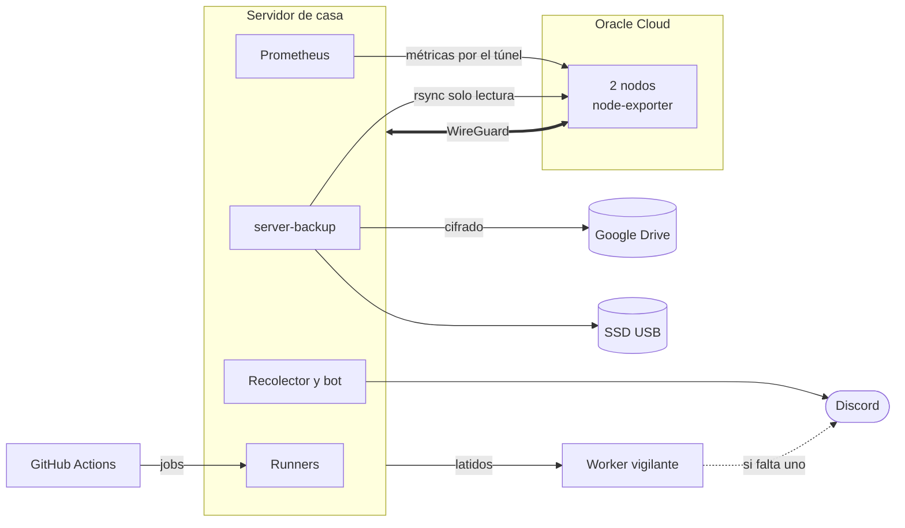

# Arquitectura

## Tráfico de entrada

## Operación

## Por dónde entra cada cosa

**Webs públicas y el panel.** Entran por Cloudflare Tunnel: cloudflared abre la conexión desde el servidor y las peticiones llegan a nginx por loopback. El router no tiene abiertos ni el 80 ni el 443. Como todo llega desde `127.0.0.1`, nginx toma la IP real de `CF-Connecting-IP`, pero solo si la petición viene de la propia máquina. Así el límite de intentos de login del panel sigue siendo por persona. El paso de puertos abiertos al túnel está contado en el [runbook](runbook-panel-por-tunel.md).

**Servidores de juego.** Wings (su API y su SFTP) y los puertos de juego van directos: por el router en casa y por la IP pública en los nodos. El navegador abre la consola contra el nodo, no contra el panel, y los juegos necesitan la IP.

**Servicios de casa.** Cada uno con su nombre y su vhost. El DNS público apunta a la IP de la LAN, así que desde fuera no llevan a ningún sitio, y el vhost además solo deja entrar a la red de casa.

**Nodos.** El panel de casa les habla por su API pública, como a cualquier nodo de Pterodactyl. Lo demás (métricas, estado del sistema) va por un túnel WireGuard que abre el servidor de casa, así que en casa no hace falta abrir ningún puerto. Los backups de sus volúmenes los trae el servidor de casa por rsync con una clave que en el nodo solo puede leer. El detalle está en [Red y seguridad](red-y-seguridad.md) y en [Backups](backups.md).

**Avisos.** Salen de dentro (el bot, Alertmanager, el script de backups) y de fuera (un Worker de Cloudflare que espera latidos). Si el servidor cae entero, avisa el de fuera.
